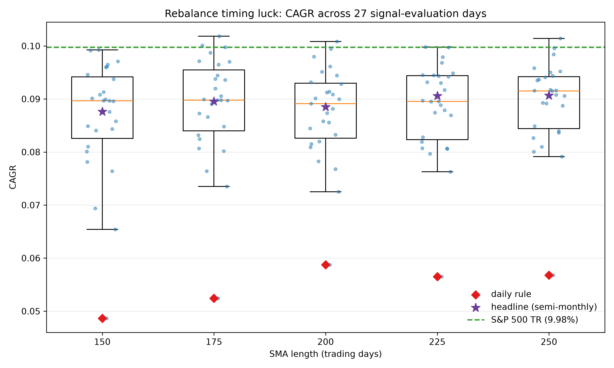

# Methodology and results in detail

This page holds the full analysis behind the [README](../README.md). Tables cite the file in
[`reports/`](../reports) they come from. Earlier measurements that were later corrected, including
everything before the 2026-10-23 rerun, are kept in [audit_history.md](audit_history.md); how to
rerun everything is in [reproducing.md](reproducing.md).

Throughout, "index", "S&P 500 total return" and "buy and hold" mean SPY's CRSP daily total
return (`config.SP500_TR_SOURCE = "SPY_PROXY"`), which is net of the ETF's expense ratio.

## Strategy definition

The strategy evaluates the holdings underlying `VOO` on a point-in-time basis and holds only constituents trading above their `200-day SMA`, allocating capital equally across active names and routing the remainder to cash when breadth collapses.

For each eligible constituent:

1. Compute the `200-day SMA` on adjusted close.
2. Mark the name `active` when price is above its SMA.
3. On rebalance dates, allocate equally across active names.
4. If no names are active, stay in cash.
5. Execute at the next session open with modeled implementation costs.
6. Skip reweights smaller than 25 bps of NAV for names that stay held; entries and exits always trade, and when entries need more than the cash available, only the names being traded are scaled.

The 200-day average uses prices from 1993-01-29 onward, so it is defined on the first sample day (1996-01-02). The $5 price filter uses the raw CRSP price and ADV uses traded dollar volume.

Default reporting schedule is `semi_monthly`, with full comparisons against `daily`, `weekly`, and `monthly`.

## Design choices

- **Point-in-time universe construction** from CRSP, with S&P membership
  history and tape-specific terminal handling: legacy `dlret` is compounded
  into its final row, while CIZ `DlyRet` already carries `DelRet` on the
  documented post-delist `DelDlyDt` row
- **Retail-implementable cost model**: EDGE effective spreads (Ardia, Guidotti & Kroencke, JFE 2024), opening-auction slippage, participation-based impact, and FINRA regulatory fees. Making costs the centrepiece rather than an afterthought is supported by ["Implementation Risk in Portfolio Backtesting"](https://arxiv.org/abs/2603.20319) (Yin, Miki, Lesnichenko & Gural, 2026), which ran 15 strategies across five open-source backtesting engines and found the engines agree exactly at zero cost ("isolating transaction-cost implementation as the sole source of disagreement") with divergence reaching 3.71% for high-turnover strategies, which at 4.5x annual turnover is the regime this strategy sits in
- **Multiple-testing-aware validation**: Deflated Sharpe Ratio over the SMA-length sweep, with the full configuration grid as the trial pool
- **A universe integrity audit** (`audit_universe.py`) that checks the CRSP ticker→PERMNO mapping is point-in-time correct, and a resolver (`permno_resolution.py`) that fixes it. With a CRSP name-history extract (`CRSP_NAMES_PATH`), `panel.build_panel` resolves every membership interval to the PERMNO that was the member and rebuilds that member's price history from it (`assemble_member_prices`); the loaders themselves match tickers by date in `data_loader._resolve_crsp_name_history`

That last item is what this repository is currently most useful for. The strategy is a 200-day SMA, deliberately simple. The infrastructure around it is the substance, and running the audit against it produced the finding described in [audit_history.md](audit_history.md#the-universe-audit-that-prompted-the-rerun).

## What the pipeline does

- Builds a point-in-time constituent universe using:
  - SEC-based `VOO` holdings proxy post-2019
  - public S&P 500 membership history proxy pre-2019
- Fetches price history from `CRSP/WRDS`, the single price source
- Simulates daily, weekly, semi-monthly, and monthly rebalance schedules
- Applies realistic implementation assumptions:
  - next-session open execution
  - dynamic cash rates via FRED `DGS3MO` when `FRED_API_KEY` is set; the published runs
    had no key and used the flat 2% `CASH_RATE_ANNUAL` fallback, as the daily-return
    manifests in `reports/` record
  - spread, impact, slippage, and regulatory-fee modeling
  - frozen input snapshots and run manifests for reproducibility
- Produces a full research report:
  - equity curves
  - drawdowns
  - rolling Sharpe
  - active breadth
  - cost diagnostics
  - schedule comparison
  - SMA parameter sweep

## Realism features

- Point-in-time constituent membership
- Snapshot-backed vendor inputs
- CRSP price sourcing, PERMNO-keyed and point-in-time
- Time-varying cash sleeve using `DGS3MO` (optional; the published runs used a flat 2%)
- Retail-implementable cost model:
  - opening-auction slippage
  - EDGE spread estimator (Ardia, Guidotti, Kroencke, JFE 2024) by default, Corwin-Schultz retained for comparison
  - participation-based impact
  - FINRA sell-side regulatory fee support
- Output manifests for deterministic reruns

## Statistical checks

- The SMA-length sweep and schedule comparison constitute a multiple-testing search, so the report includes the Deflated Sharpe Ratio (Bailey and Lopez de Prado 2014) for the selected configuration and for every sweep entry, with the full sweep treated as the trial pool. A high raw Sharpe with a low deflated Sharpe means the configuration choice is not statistically distinguishable from picking the best of several noise strategies.
- The Probability of Backtest Overfitting (CSCV; Bailey, Borwein, López de Prado & Zhu 2017) is reported alongside the Deflated Sharpe over the same five-length sweep. The two answer different questions: DSR asks whether the selected Sharpe survives the search, PBO asks whether the in-sample ranking predicts the out-of-sample ranking at all.
- Trade-level profit concentration (`profit_top5pct_share`, `profit_top10pct_share`) is reported because single-stock trend following concentrates most profit in a small tail of trades; averages alone hide this dependence.
- CRSP delisting returns (`dsedelist.dlret`) are compounded into the final return of names that exit, so departures do not silently leave at their last quoted price.

## Headline result

All tables below are from the offline rerun of 2026-10-23 (see
[the correction](audit_history.md#correction-2026-10-23-rerun-after-the-code-review)). Source:
[`tape_comparison_corrected.csv`](../reports/tape_comparison_corrected.csv) (legacy tape) and
[`results_summary.csv`](../reports/results_summary.csv).

| metric | strategy (SMA-200, semi-monthly) | SPY buy and hold |
|---|---|---|
| CAGR | 8.85% | 9.98% |
| annualised volatility | 16.35% | 19.27% |
| Sharpe, (CAGR - 2%) / vol | 0.419 | 0.414 |
| max drawdown | 52.1% | 55.2% |
| annual turnover | 5.71 | 0.03 |
| annualised cost | 85 bps | 0 |
| trades | 36,667 | |
| Deflated Sharpe (9 trials) | 0.993 | |

The strategy gives up 1.13 pp of CAGR a year. It holds cash when breadth collapses, so it runs at
lower volatility and a slightly smaller drawdown, which leaves its Sharpe ratio level with SPY's.
That small Sharpe advantage is not an edge: the next section tests it.

Rebalance frequency matters more than any other choice
([`schedule_comparison.csv`](../reports/schedule_comparison.csv)): daily evaluation earns 5.87%
at 18.0x turnover, weekly 7.25%, semi-monthly 8.85% and monthly 9.22% at 4.1x.

## Multiple testing

Five SMA lengths and four rebalance schedules were run, so the headline is the survivor of a small
search. Three checks, all on the 2026-10-23 rerun:

| check | result | source |
|---|---|---|
| Romano-Wolf stepdown, each SMA length against SPY, 5% family-wise error | 0 of 5 significant; every mean daily excess return over SPY is negative (t from -0.94 to -1.12) | [`romano_wolf_sweep.csv`](../reports/romano_wolf_sweep.csv) |
| Deflated Sharpe of the pre-specified SMA-200, 9 trials (5 lengths + 4 schedules) | 0.993 | [`sma_sweep.csv`](../reports/sma_sweep.csv) |
| Probability of backtest overfitting (CSCV, 16 blocks, 12,870 splits, 7,296 days) | 0.867; the in-sample winner's median out-of-sample rank is 2 of 5 (1 = worst) | [`pbo_sweep.csv`](../reports/pbo_sweep.csv) |

The Deflated Sharpe tests the selected configuration's excess return over cash: the search did not
manufacture a positive Sharpe. The other two tests answer the questions that matter for a strategy
decision, and both say there is nothing to select. No length beats simply holding SPY, and picking
the length with the best in-sample Sharpe is worse than useless out of sample: with five
configurations an uninformative ranking scores a PBO of 0.60, and this one scores 0.867. The
pre-specified 200 days ranks 4th of 5 on full-sample Sharpe (`sma_250` is best); that ordering is
not evidence of anything.

`statistics_mt.probability_of_backtest_overfitting` implements combinatorially symmetric
cross-validation (Bailey, Borwein, López de Prado and Zhu, *Journal of Computational Finance*
20(4), 2017): the daily return panel is cut into 16 contiguous blocks, every half/half split is
enumerated, and PBO is the share of splits in which the in-sample winner ranks in the bottom half
out of sample. The four trailing days that cannot fill a 16th equal block are dropped. Ranking uses
the per-period mean over standard deviation of raw daily returns; the Deflated Sharpe uses returns
in excess of the 2% cash rate, in both `main.py` and `run_pbo.py`.

## Which CRSP tape

In January 2025 CRSP shipped the last release of Flat File Format 1.0 (SIZ) and now updates only Format 2.0 (CIZ). Schwarz, Walter and Weiss, ["Rewriting CRSP's History: Impact of Altered Monthly Returns on Asset Pricing"](https://doi.org/10.2139/ssrn.5074864) (*Journal of Financial and Quantitative Analysis*, 24 February 2026), measure the consequence: the transition "rewrites 9.62% of monthly returns by more than 1 basis point, primarily due to a change in the dividend reinvestment assumption", payouts reinvesting on the ex-date under CIZ against month-end under SIZ. The reinvestment change is a *monthly* artefact (daily returns "did not change materially"), so a strategy evaluated on daily data should be close to tape-invariant.

`crsp_v2.py` re-pulls the whole constituent panel from `crsp.dsf_v2` and `run_tape_compare.py`
reruns the headline configuration on both tapes, holding the PERMNO resolution, membership,
costs, endpoint and normalisation path fixed so that only CRSP's numbers change. CIZ already
includes `DelRet` in `DlyRet` on `DelDlyDt`, the trading day after delisting; post-delist CIZ rows
that legacy name-end filtering dropped are restored from a verified `crsp.stkdelists` extract
([`ciz_source_validation.csv`](../reports/ciz_source_validation.csv)). The 2026-10-23 rerun read
CIZ caches already corrected with that extract (`terminal-v3-7fe0edc5a632`), and marked terminal
sessions from the events those caches carry.

| result | legacy `crsp.dsf` | CIZ `crsp.dsf_v2` |
|---|---|---|
| tickers resolved | 1,133 | 1,133 |
| covered constituent-days | 5,436,345 | 5,426,529 |
| terminal sessions | 652 | 601 |
| trading days | 7,300 | 7,299 |
| strategy CAGR | 8.848% | 8.879% |
| strategy Sharpe | 0.4187 | 0.4209 |
| strategy max drawdown | 52.14% | 52.00% |
| annual turnover | 5.713 | 5.721 |
| trades | 36,667 | 36,860 |
| annualised cost | 85.1 bps | 85.2 bps |
| SPY CAGR | 9.977% | 10.039% |
| SPY Sharpe | 0.4140 | 0.4172 |

Sources: [`tape_comparison_corrected.csv`](../reports/tape_comparison_corrected.csv),
[`tape_coverage_corrected.csv`](../reports/tape_coverage_corrected.csv).

| constituent-day comparison at 1 bp | ordinary sessions | terminal sessions |
|---|---|---|
| comparable ticker-days | 5,425,294 | 634 |
| differ by more than 1 bp | 38 (0.0007%) | 599 (94.5%) |
| median absolute difference among altered days | 146.7 bps | 79.0 bps |
| mean absolute difference among altered days | 243.5 bps | 496.0 bps |
| covered by legacy only | 9,645 | 17 |
| covered by CIZ only | 0 | 601 |
| identifier mismatches | 0 | 0 |

Source: [`tape_return_differences_by_session_corrected.csv`](../reports/tape_return_differences_by_session_corrected.csv).
Across all sessions 5,425,928 ticker-days are comparable and 637 differ by more than 1 bp
([`tape_return_differences_corrected.csv`](../reports/tape_return_differences_corrected.csv)).

Daily returns agree on ordinary sessions. Nearly every altered observation is a terminal session,
where the two tapes date the final return differently; the 601 CIZ-only rows are the restored
post-delist rows, a convention difference that is kept rather than removed by double counting. The
38 ordinary-session differences were 1 when terminal sessions were marked from the full extract
(see the audit history); some may be delisting days that the extract, which this rerun did not
have, would classify as terminal.

The strategy stays close across tapes: CIZ raises CAGR by 3.0 bps and Sharpe by 0.002. Across
7,299 common strategy days, 1,630 differ by more than 1 bp, the mean absolute gap is 0.80 bp and
the largest is 194.3 bps. The tapes' benchmark calendars differ by one day: legacy carries SPY on
1997-03-31 with zero volume and CIZ does not, so the CIZ panel has 7,299 sessions.

Every other table on this page uses the legacy tape, which ends in December 2024 like the sample.

## How much of a moving-average result is the calendar

Hoffstein, Sibears and Faber, ["Rebalance Timing Luck: The Difference between Hired and Fired"](https://doi.org/10.2139/ssrn.3319045) (*The Journal of Index Investing* 10(1), 2019, 27-36), show that two portfolios running an identical rule and differing only in which day inside the period they rebalance on are different portfolios; the spread between them is *rebalance timing luck*. Their follow-up with Braun, ["Rebalance Timing Luck: The (Dumb) Luck of Smart Beta"](https://doi.org/10.2139/ssrn.3673910) (2020), measures it above 100 bps annualised for long-only factor indices.

`timing_luck.py` runs all five SMA lengths against 27 signal-evaluation schedules: daily, five weekly
anchors and twenty-one monthly anchors, with anchors defined as trading-day ordinals. The semi-monthly
headline schedule rides along as a 28th labelled row per length (140 rows in all) and is excluded
from every dispersion statistic. Source: [`timing_luck_summary.csv`](../reports/timing_luck_summary.csv)
and [`timing_luck_variants.csv`](../reports/timing_luck_variants.csv).

| SMA | daily rule | headline (semi-monthly) | worst of 27 | best of 27 | CAGR range | CAGR s.d. | Sharpe range | gap, daily to index | range / daily gap | gap, headline to index | range / headline gap |
|---|---|---|---|---|---|---|---|---|---|---|---|
| 150 | 4.87% | 8.76% | 4.87% | 9.93% | 5.06 pp | 1.14 pp | 0.310 | 5.11 pp | 0.99 | 1.21 pp | 4.17 |
| 175 | 5.24% | 8.96% | 5.24% | 10.18% | 4.94 pp | 1.03 pp | 0.308 | 4.74 pp | 1.04 | 1.02 pp | 4.84 |
| 200 | 5.87% | 8.85% | 5.87% | 10.08% | 4.21 pp | 0.90 pp | 0.258 | 4.10 pp | 1.03 | 1.13 pp | 3.73 |
| 225 | 5.65% | 9.06% | 5.65% | 9.98% | 4.33 pp | 0.91 pp | 0.275 | 4.32 pp | 1.00 | 0.92 pp | 4.72 |
| 250 | 5.68% | 9.07% | 5.68% | 10.14% | 4.46 pp | 0.88 pp | 0.273 | 4.30 pp | 1.04 | 0.91 pp | 4.91 |

- **Daily evaluation is the worst schedule at every length, and a monthly anchor is the best.** At
  200 days the daily rule turns over 18.0 times a year against 4.1 for the monthly anchors, which at
  about 15 bps a trade is 268 bps of annual cost against 61 bps. That cost gap is 42% to 50% of the
  range at each length, the largest single driver but not all of it.
- **The schedule matters about as much as the strategy's whole gap to the index.** The CAGR range
  across the 27 schedules is 0.99 to 1.04 times the gap between the daily rule and buy-and-hold.
- **The headline sits mid-pack.** At 200 days semi-monthly ranks 14th lowest of the 27 anchors.
- **A few calendars beat the index on CAGR, none on a test.** Five of the 135 anchor variants end
  above SPY's 9.98% CAGR (best 10.18%, SMA-175 on the 17th trading day of each month), and 83 have a
  higher (CAGR minus cash) / volatility ratio than SPY's 0.414 because the rule runs at lower
  volatility. These are the luckiest draws of a 135-way search; the Romano-Wolf and PBO results
  above are the guard against reading them as an edge.

### Holding the frequency fixed

The pooled range mixes how often the rule trades with which day it trades on. Splitting the
squared dispersion into within- and between-frequency parts (one vote per anchor; descriptive, not
an ANOVA test) separates them. Sources: [`timing_luck_by_frequency.csv`](../reports/timing_luck_by_frequency.csv),
[`timing_luck_frequency_decomposition.csv`](../reports/timing_luck_frequency_decomposition.csv).

| SMA | pooled CAGR range | weekly-only range (5 anchors) | monthly-only range (21 anchors) | between-frequency share of squared dispersion |
|---|---|---|---|---|
| 150 | 5.06 pp | 1.56 pp | 1.92 pp | 78.1% |
| 175 | 4.94 pp | 0.89 pp | 1.86 pp | 78.0% |
| 200 | **4.21 pp** | **0.90 pp** | **1.89 pp** | **71.7%** |
| 225 | 4.33 pp | 0.65 pp | 1.92 pp | 74.2% |
| 250 | 4.46 pp | 0.57 pp | 1.88 pp | 78.1% |

Frequency explains most of the spread, but the anchor alone still moves the 200-day CAGR by 1.89 pp
across monthly calendars. Primary literature and remaining checks are in
[the review notes](schedule_review_2026.md). Offline check: `python run_schedule_audit.py --check`.

## Index versus stock

Zakamulin's evidence against moving-average timing (cited in [audit_history.md](audit_history.md#what-the-literature-says))
is index-level. This compares the same five rules applied to SPY's total-return series, same cost
model, same daily evaluation. The index rule pays SPY's EDGE spread, which averages 21.3 bps
(VOO's, from 2011, averages 18.4 bps; [`index_spread_notes.csv`](../reports/index_spread_notes.csv)). Sources:
[`index_vs_stock.csv`](../reports/index_vs_stock.csv), [`index_vs_stock_decomposition.csv`](../reports/index_vs_stock_decomposition.csv).

| SMA | index CAGR | index Sharpe | index max DD | constituent CAGR | constituent Sharpe | constituent max DD |
|---|---|---|---|---|---|---|
| 150 | 5.55% | 0.290 | 38.5% | 4.87% | 0.176 | 67.0% |
| 175 | 6.73% | 0.383 | 30.6% | 5.24% | 0.201 | 65.4% |
| 200 | **7.60%** | **0.451** | 25.1% | 5.87% | 0.239 | 64.4% |
| 225 | 7.76% | 0.460 | 25.9% | 5.65% | 0.225 | 64.7% |
| 250 | 7.71% | 0.445 | 25.8% | 5.68% | 0.228 | 62.9% |
| *buy and hold* | *9.98%* | *0.414* | *55.2%* | | | |

With daily evaluation the index-level rule beats the constituent-level rule at every length, and at
200 days it has a higher Sharpe than buy-and-hold (0.451 against 0.414) on less than half the
drawdown, while giving up 2.38 pp of CAGR. Splitting the shortfall with a costs-off rerun
(`shortfall = whipsaw + cost`, exact by construction):

| SMA | shortfall | whipsaw component | cost component |
|---|---|---|---|
| 150 | 0.68 pp | -1.34 pp | 2.02 pp |
| 175 | 1.49 pp | -0.47 pp | 1.95 pp |
| 200 | 1.73 pp | -0.12 pp | 1.85 pp |
| 225 | 2.11 pp | 0.42 pp | 1.69 pp |
| 250 | 2.03 pp | 0.31 pp | 1.73 pp |

The constituent rule loses on cost, not on signal: gross of costs it beats the index rule at 150,
175 and 200 days. At 150 days it turns over 21.7 times a year against the index rule's 9.6, and it
pays per-name spreads instead of an ETF's.

## Volatility-managed control

The control is Moreira and Muir, ["Volatility-Managed Portfolios"](https://doi.org/10.1111/jofi.12513) (*The Journal of Finance* 72(4), 2017, 1611-1644): exposure `c / RV`, trailing 21-day realised variance, capped at 1.5. The first half of the sample (1996-01-02 to 2010-07-01) calibrates `c`; every statistic below uses only 2010-07-02 to 2024-12-31. Source: [`vol_managed_control_corrected.csv`](../reports/vol_managed_control_corrected.csv).

| leg | variant | held-out CAGR | vol | Sharpe | Sharpe (arith.) | max DD | turnover |
|---|---|---|---|---|---|---|---|
| SPY | buy and hold | 14.88% | 16.93% | 0.761 | 0.787 | 33.7% | 0.0 |
| SPY | monthly, gross | 13.79% | 15.11% | 0.780 | 0.800 | 21.9% | 3.9 |
| SPY | monthly, net | 13.18% | 15.10% | 0.740 | 0.764 | 22.0% | 3.9 |
| SPY | daily, net | 11.63% | 13.61% | 0.707 | 0.731 | 15.5% | 8.0 |
| equal-weight constituents | buy and hold | 13.85% | 18.27% | 0.649 | 0.693 | 39.8% | 0.0 |
| equal-weight constituents | monthly, net | 8.77% | 14.68% | 0.461 | 0.511 | 27.8% | 4.3 |
| constituent SMA-200 (daily) | buy and hold | 10.04% | 14.94% | 0.538 | 0.583 | 29.0% | 0.0 |
| constituent SMA-200 (daily) | monthly, net | 7.88% | 14.38% | 0.409 | 0.461 | 24.1% | 4.2 |

The monthly overlay on SPY lifts geometric Sharpe from 0.761 to 0.780 before costs and loses it to
costs (0.740). On the two constituent legs the overlay lowers Sharpe even before costs. Romano-Wolf
testing over all six net overlays against their own buy-and-hold rejects none at 5% family-wise
error; every mean excess return is negative and adjusted p-values run from 0.920 to 1.000
([`vol_managed_romano_wolf_corrected.csv`](../reports/vol_managed_romano_wolf_corrected.csv)).
Cederburg, O'Doherty, Wang and Yan, ["On the performance of volatility-managed portfolios"](https://doi.org/10.1016/j.jfineco.2020.04.015) (*Journal of Financial Economics* 138(1), 2020, 95-117), find the same for most factors in real-time implementation.

The held-out daily series for the constituent legs and the cash sleeve are committed in
`reports/vol_managed_constituent_daily_returns.csv.gz`; the SPY leg is only in the local
`output/evidence/` copy. `python verify_corrected_reports.py` recomputes every row it has a series for.

## Known limits

- Pre-2019 constituent history is still proxy-based, not a licensed S&P point-in-time master.
  Bankruptcy "Q" symbols that CRSP never listed stay unresolved, and the 2026-10-23 rerun had no
  cached prices for some resolved members' earlier tickers (listed in the audit history).
- Adjusted-open execution on daily data is an approximation, even with QA repair.
- Corporate-event outliers in crisis periods can still exist in constituent data and should be reviewed before live deployment.
- **Frequency and anchor sensitivity differ.** The pooled 27-schedule range mixes both; neither table supplies an uncertainty interval for the semi-monthly headline.
- **The index-level spread is SPY's throughout.** CRSP's first usable VOO estimate is 2011; SPY's EDGE spread averages 21.3 bps against VOO's 18.4 bps over the 3,477-day overlap.
- **CIZ delisting returns are bridged through the CIZ delisting table.** 601 CIZ-only terminal rows are restored; 599 of 634 comparable terminal observations differ from the legacy tape by more than 1 bp because the tapes date the delisting return differently.
- **The volatility-managed control is only a control.** Calibrated on the first half and evaluated on 2010-07-02 to 2024-12-31, no net overlay beats its own buy-and-hold in the Romano-Wolf test.
- The cash sleeve earns a flat 2% and borrows at that rate when the volatility overlay levers up to its 1.5 cap. A retail account pays more, so that leg is flattered.
- **WRDS defaults to disabled.** Both CRSP loaders refuse a connection unless `WRDS_DUO_READY=1` is set for the current session, which triggers a Duo push. See [reproducing.md](reproducing.md#wrds-access).

## Intended use

This codebase is designed for research-grade backtesting and strategy evaluation, not for direct live trading deployment without a licensed point-in-time constituent master and broker-specific transaction-cost calibration.
